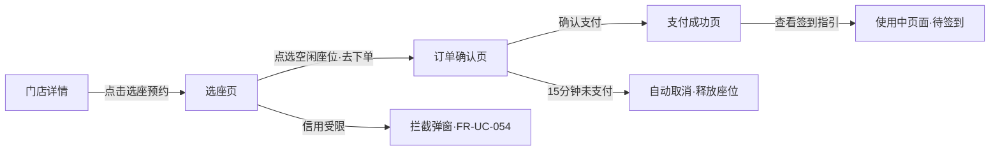
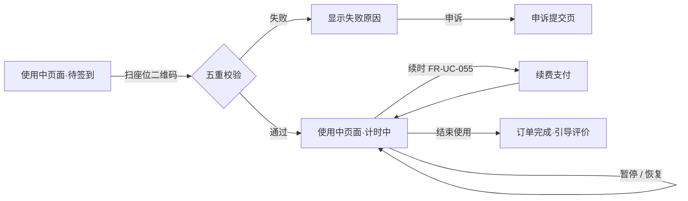

# 无人自习室小程序 UI 原型设计文档

> 信息架构图 + 各页面线框说明，对应《技术选型与功能汇总》2.1 用户端功能（FR-UC-001 ~ FR-UC-055）。
>
> 说明：文中 ASCII 线框图用于表达布局结构与模块层级，论文成稿时建议用墨刀 / draw.io 按相同结构重绘为标准线框图（低保真）与高保真原型图。

---

## 一、设计概述

| 项目 | 说明 |
|------|------|
| 设计范围 | 微信小程序用户端全部页面（单店模式） |
| 设计基准 | 750rpx 设计稿（iPhone 6/7/8 基准），1px = 2rpx |
| 设计规范 | 微信官方《小程序设计指南》+ WeUI 视觉规范 |
| 组件库 | Vant Weapp 1.11.x（原型组件与开发组件一一对应，避免还原偏差） |
| 图表库 | echarts-for-weixin（学习统计页） |
| 推荐工具 | 墨刀 MockingBot / 即时设计（线框与高保真）；draw.io / Visio（信息架构图、流程图） |

**设计原则**：任务导向（预约-签到-离场三步触达）、状态可视化（座位/订单/倒计时全部用颜色语义表达）、轻量引导（新用户无感登录，隐私弹窗仅首次）。

---

## 二、全局视觉规范

### 2.1 色彩系统

| 类别 | 色值 | 用途 |
|------|------|------|
| 主色 | `#2BAE85` | 主按钮、选中态、品牌元素 |
| 辅助色 | `#07C160` | 成功状态、微信生态色 |
| 警告色 | `#EE9C01` | 维护中、到期提醒 |
| 危险色 | `#EE0A24` | 取消、待支付倒计时、爽约提示 |
| 一级文字 | `#323233` | 标题、正文 |
| 二级文字 | `#646566` | 说明文字 |
| 三级文字 | `#969799` | 提示、占位 |
| 页面背景 | `#F7F8FA` | 全局背景 |
| 卡片背景 | `#FFFFFF` | 卡片、弹窗 |
| 分割线 | `#EBEDF0` | 列表分割线 |

**语义色（与功能编号严格对应）**：

| 语义组 | 状态 → 色值 | 对应功能 |
|--------|------------|---------|
| 座位 6 色 | 空闲 `#2BAE85` / 占用 `#909399` / 使用中 `#1989FA` / 维护 `#EE9C01` / 打扫 `#FFB800` / 锁定 `#EE4F12` | FR-UC-017 |
| 倒计时 3 色 | 待支付 红 `#EE0A24` / 已预约 蓝 `#1989FA` / 进行中 绿 `#07C160` | FR-UC-036 |
| 营业状态 3 色 | 营业中 绿 / 休息中 灰 / 维护中 橙 | FR-UC-008 |

### 2.2 字体字号

| 场景 | 字号 | 字重 |
|------|------|------|
| 导航栏标题 | 34rpx | 500 |
| 页面大标题 / 余额数字 | 40rpx | 600 |
| 正文 | 28rpx | 400 |
| 辅助说明 / 标签 | 24rpx | 400 |
| 按钮文字 | 30rpx | 500 |
| 倒计时数字 | 32rpx | 等宽字体（防止跳动） |

### 2.3 布局与间距

- 页面左右边距 32rpx；卡片圆角 16rpx
- 卡片间距 24rpx，模块间距 32rpx
- 主按钮高 88rpx（底部固定操作栏），次要按钮 64rpx
- 底部 TabBar 高 100rpx + iPhone 底部安全区

### 2.4 通用组件

| 组件 | 规格 | 说明 |
|------|------|------|
| 自定义导航栏 | Vant NavBar | 页面标题 + 返回箭头，全局统一 |
| TabBar | 4 个 Tab | 首页 / 预约 / 订单 / 我的 |
| 空状态 | 插画 + 文案 + 引导按钮 | 订单、消息、公告无数据时 |
| 骨架屏 | Vant Skeleton | 首页、订单列表加载态 |
| 倒计时 | 等宽数字 + 语义色 | 订单卡片、使用中页面 |
| 危险操作弹窗 | Vant Dialog | 取消订单、结束使用二次确认 |

---

## 三、信息架构

### 3.1 TabBar 定义

| Tab | 名称 | 图标建议 | 页面 | 对应功能 |
|-----|------|---------|------|---------|
| 1 | 首页 | 房屋 | pages/home/index | FR-UC-007 ~ 011 |
| 2 | 预约 | 座位 | pages/store/detail | FR-UC-015 ~ 021 |
| 3 | 订单 | 单据 | pages/order/list | FR-UC-035 ~ 038 |
| 4 | 我的 | 用户 | pages/mine/index | FR-UC-048 ~ 052 |

> 订单设为一级 Tab 的理由：订单是使用频次最高的功能（6 状态切换 + 倒计时 + 多操作按钮），需要全局随时可达。

### 3.2 信息架构图（页面树）

```
无人自习室小程序
│
├── Tab1 首页
│   ├── 公告滚动条 ──────→ 公告列表 ──→ 公告详情
│   ├── 快捷操作区
│   │   ├── 扫码签到 ────→ 扫码签到流程 → 使用中页面
│   │   ├── 钱包充值 ────→ 钱包页
│   │   ├── 学习统计 ────→ 学习统计页
│   │   └── 消息中心 ────→ 消息中心页
│   └── 门店卡片 ────────→ 门店详情（Tab2）
│
├── Tab2 预约（门店详情）
│   ├── 评价摘要 ────────→ 门店评价列表
│   └── [选座预约] ──────→ 选座页
│       │                  （日期时段 + 套餐 + Canvas 座位图）
│       └── [去下单] ────→ 订单确认页
│           │               （优惠券 + 支付方式）
│           └── [确认支付] → 支付成功页
│               │            └─→ 使用中页面（待签到态）
│               └─→ 15分钟未支付 → 订单自动取消（超时释放）
│
├── Tab3 订单列表（6 状态 Tab）
│   └── 订单卡片 / 订单详情
│       ├── 去支付 ────→ 订单确认页
│       ├── 签到 ──────→ 扫码签到流程 → 使用中页面
│       ├── 评价 ──────→ 评价提交页
│       └── 取消 ──────→ 阶梯退款计算 → 余额退回
│
├── Tab4 我的
│   ├── 个人信息编辑（头像昵称授权）
│   ├── 钱包（余额 / 充值 / 交易记录）
│   ├── 学习统计（柱状图 + 打卡热力图）
│   ├── 使用中订单入口
│   └── 设置
│       ├── 邮箱绑定
│       ├── 消息通知设置
│       ├── 隐私设置
│       ├── 意见反馈
│       └── 缓存清理
│
├── 全局入口
│   ├── 使用中页面（待签到 / 使用中两态，含暂停 / 恢复 / 结束 / 续时）
│   ├── 申诉提交页（签到失败入口）
│   ├── 消息中心（首页 / 订单页角标入口）
│   └── 隐私弹窗（首次启动，FR-UC-050）
│
└── 异常态
    └── 信用限制拦截（FR-UC-054：30 天内爽约 3 次，下单时弹窗拦截）
```

### 3.3 核心流程图（页面跳转维度）

**预约支付流程**



**签到与使用流程**



### 3.4 页面清单总表

| # | 页面 | 建议路由 | 对应功能 | 进入方式 |
|---|------|---------|---------|---------|
| 1 | 首页 | pages/home/index | FR-UC-007~011 | Tab1 |
| 2 | 门店详情 | pages/store/detail | FR-UC-015 | Tab2 / 首页卡片 |
| 3 | 选座页 | pages/store/seat | FR-UC-016~021 | 门店详情按钮 |
| 4 | 订单确认页 | pages/order/confirm | FR-UC-022~024 | 选座页下单 |
| 5 | 支付成功页 | pages/order/success | FR-UC-028 | 支付回调成功 |
| 6 | 订单列表 | pages/order/list | FR-UC-035~037 | Tab3 |
| 7 | 订单详情 | pages/order/detail | FR-UC-038 | 订单卡片 |
| 8 | 使用中页面 | pages/using/index | FR-UC-029~034、055 | 支付成功 / 订单签到 / 我的 |
| 9 | 申诉提交页 | pages/appeal/submit | FR-UC-032 | 签到失败 |
| 10 | 评价提交页 | pages/review/submit | FR-UC-039 | 订单完成引导 |
| 11 | 门店评价列表 | pages/review/list | FR-UC-040 | 门店详情评价摘要 |
| 12 | 公告列表 | pages/notice/list | FR-UC-041~042 | 首页公告条 |
| 13 | 公告详情 | pages/notice/detail | FR-UC-043 | 公告列表 |
| 14 | 消息中心 | pages/message/index | FR-UC-047 | 首页/订单页角标 |
| 15 | 钱包页 | pages/wallet/index | FR-UC-048 | 我的 / 快捷操作 |
| 16 | 学习统计页 | pages/stats/index | FR-UC-049 | 我的 / 快捷操作 |
| 17 | 我的 | pages/mine/index | FR-UC-048~052 | Tab4 |
| 18 | 邮箱绑定 | pages/mine/email | FR-UC-004 | 设置列表 |
| 19 | 全局弹窗 | 隐私弹窗 / 信用限制弹窗 | FR-UC-050、054 | 首次启动 / 下单拦截 |

---

## 四、各页面线框说明

> 线框图按竖屏手机比例绘制；每个页面附「区域说明」与「交互要点」。

### 4.1 首页（Tab1）

```
┌──────────────────────────────┐
│  自习室            [📍 1.2km] │  ← 自定义导航 + 定位距离
├──────────────────────────────┤
│ ┌──────────────────────────┐ │
│ │       Banner 轮播  1/3   │  │  ← swiper 自动轮播
│ └──────────────────────────┘ │
│  📢 公告标题滚动条…        [>] │  ← 点击进入公告列表
│ ┌────┐ ┌────┐ ┌────┐ ┌────┐ │
│ │扫码 │ │充值 │ │统计 │ │消息 │  │  ← 快捷操作 4 宫格
│ └────┘ └────┘ └────┘ └────┘ │
│ ┌──────────────────────────┐ │
│ │ ●营业中   悦读自习室        │ │
│ │ ⭐4.8 ｜ 距离 1.2km        │ │  ← 门店卡片
│ │ 今日空位  12/50（大字号）    │ │
│ │ [空调] [静音区] [插座]      │ │  ← 设施标签
│ │           [ 立即预约 → ]   │ │
│ └──────────────────────────┘ │
├──────────────────────────────┤
│  首页    预约    订单    我的   │
└──────────────────────────────┘
```

| 区域 | 内容与组件 | 功能编号 | 交互说明 |
|------|-----------|---------|---------|
| 导航区 | 自定义标题 + 定位距离 | FR-UC-007 | Haversine 计算距离，未授权定位显示"获取定位" |
| Banner | swiper 轮播 3~5 张 | FR-UC-009 | 自动轮播 3s，点击跳转对应活动 |
| 公告条 | 单行滚动 + 未读红点 | FR-UC-009/042 | 点击进入公告列表 |
| 快捷操作 | 4 宫格图标按钮 | FR-UC-009 | 扫码签到直调 wx.scanCode；消息入口带未读角标 |
| 门店卡片 | 状态色点 + 空位数 + 评分 + 标签 | FR-UC-008/010 | 空位数实时刷新；卡片点击进门店详情 |

**交互要点**：下拉刷新同步门店状态 / 空位 / 公告（FR-UC-011）；首次进入显示骨架屏；营业状态色点遵循三色语义（FR-UC-008）。

### 4.2 门店详情（Tab2）

```
┌──────────────────────────────┐
│  ←  门店详情                   │
├──────────────────────────────┤
│ ┌──────────────────────────┐ │
│ │     环境图片轮播  2/5      │  │
│ └──────────────────────────┘ │
│  悦读自习室        ● 营业中    │
│  ⭐4.8（128条评价）  距离1.2km │
│  📍 地址全文 …        [导航]  │  ← 调起地图
│  [空调] [静音区] [插座] [咖啡] │
│ ┌──────────────────────────┐ │
│ │ 营业时间 07:00 - 23:00     │ │
│ │ 今日空位 12/50            │ │
│ └──────────────────────────┘ │
│  用户评价（128）      [全部 >] │
│ ┌──────────────────────────┐ │
│ │ 张*  ⭐⭐⭐⭐⭐            │ │  ← 评价摘要
│ │ "很安静，插座很多…"  [图3]  │ │     2~3条 + 管理员回复
│ └──────────────────────────┘ │
├──────────────────────────────┤
│ [ 选座预约 ]                  │  ← 底部固定主按钮
└──────────────────────────────┘
```

| 区域 | 内容与组件 | 功能编号 | 交互说明 |
|------|-----------|---------|---------|
| 图片轮播 | 环境图 swiper | FR-UC-015 | 点击全屏预览 |
| 基本信息区 | 名称 / 评分 / 距离 / 状态 | FR-UC-015 | 评分点击跳评价列表 |
| 地址区 | 地址 + [导航] | FR-UC-015 | wx.openLocation 调起地图 |
| 设施标签 | 标签组 | FR-UC-015 | — |
| 评价摘要 | 2~3 条精选评价 | FR-UC-015/040 | [全部] 进评价列表页 |
| 底部按钮 | 选座预约（固定） | FR-UC-016 | 进入选座页 |

### 4.3 选座页（核心页面）

```
┌──────────────────────────────┐
│  ←  选座预约                   │
├──────────────────────────────┤
│ 今天  明天  周三  周四 …       │  ← 7天日期条（横滑）
│ ┌──────────────────────────┐ │
│ │ 08:00 08:30 09:00 …      │  │  ← 30分钟粒度时段
│ │ [■已选][□可选][■黑名单灰]  │  │     黑名单时段置灰 FR-UC-020
│ └──────────────────────────┘ │
│ [按时长] [日卡] [周卡] [月卡]  │  ← 套餐选项卡 FR-UC-019
│ ┌──────────────────────────┐ │
│ │   Canvas 座位平面图        │  │  ← 占屏 ≥50% FR-UC-017
│ │   ①号 ②号 ③号 …          │ │     6 色状态语义
│ │   [空闲■][占用■][使用中■]  │ │     图例常驻底部
│ │   [维护■][打扫■][锁定■]   │ │
│ └──────────────────────────┘ │
├──────────────────────────────┤
│ 已选：③号  14:00-16:00        │  ← 底部固定操作栏
│ 合计 ¥12.00   [ 去下单 ]      │
└──────────────────────────────┘
```

| 区域 | 内容与组件 | 功能编号 | 交互说明 |
|------|-----------|---------|---------|
| 日期条 | 今天起 7 天横滑 | FR-UC-016 | 默认选中今天 |
| 时段选择 | 30 分钟粒度网格 | FR-UC-016/020 | 黑名单 / 已过时段置灰不可点 |
| 套餐选项卡 | 时长/日卡/周卡/月卡 | FR-UC-019 | 切换联动价格与可选时段 |
| Canvas 座位图 | 6 色状态 + 图例 | FR-UC-017 | 点选空闲座位高亮，占用类座位点击弹 Toast 提示 |
| 底部操作栏 | 已选信息 + 合计 + 去下单 | FR-UC-018/021 | 提交触发原子锁座；同座位并发后到者提示"刚被预约" |

**交互要点**：去下单时若用户处于信用限制期，弹出拦截弹窗（FR-UC-054）；座位图数据变更时局部重绘 Canvas，避免整图闪烁。

### 4.4 订单确认页

```
┌──────────────────────────────┐
│  ←  确认订单                   │
├──────────────────────────────┤
│ ┌──────────────────────────┐ │
│ │ 悦读自习室 · ③号座位        │ │
│ │ 8月30日 14:00 - 16:00     │ │  ← 座位信息卡
│ │ 时段卡 · 2小时             │ │
│ └──────────────────────────┘ │
│  优惠券  [新人券 ¥5 可用 >]    │  ← 券选择（Popup 列表）
│ ┌──────────────────────────┐ │
│ │ 订单金额        ¥12.00     │ │
│ │ 优惠券抵扣      -¥5.00     │ │  ← 费用明细
│ │ ────────────────          │ │
│ │ 实付金额        ¥7.00     │ │
│ └──────────────────────────┘ │
│  支付方式                      │
│  ● 余额支付（余额 ¥56.00）     │  ← 优先展示
│  ○ 微信支付（模拟）            │
├──────────────────────────────┤
│  [ 确认支付 ¥7.00 ]           │
│  提示：请在15分钟内完成支付，   │  ← 超时规则前置告知
│  超时订单将自动取消             │
└──────────────────────────────┘
```

| 区域 | 内容与组件 | 功能编号 | 交互说明 |
|------|-----------|---------|---------|
| 座位信息卡 | 座位 / 日期 / 时段 / 套餐 | FR-UC-022 | — |
| 优惠券 | 可用券 Popup 列表 | FR-UC-024 | 默认选中最优券；不可用置灰并说明原因 |
| 费用明细 | 原价 - 优惠 = 实付 | FR-UC-022 | 三行对齐展示 |
| 支付方式 | 余额 / 模拟微信支付 | FR-UC-023 | 余额优先默认勾选；余额不足自动切换并提示 |
| 提交 | 确认支付 | FR-UC-025 | 支付中 loading 防重复提交 |

### 4.5 支付成功页

```
┌──────────────────────────────┐
│                              │
│           ✅（绿色大勾）       │  ← 缩放动画
│         支付成功              │
│ ┌──────────────────────────┐ │
│ │ 悦读自习室 · ③号座位        │ │
│ │ 8月30日 14:00 - 16:00     │ │  ← 订单摘要卡
│ │ 实付 ¥7.00                │ │
│ └──────────────────────────┘ │
│  [ 查看签到指引 ]              │  ← 主按钮 → 使用中页面
│  [ 返回订单列表 ]              │  ← 次按钮
└──────────────────────────────┘
```

**交互要点**：入场播放勾选缩放动画（FR-UC-028）；主按钮跳使用中页面（待签到态）；同步触发订阅消息授权引导（FR-UC-044）。

### 4.6 订单列表（Tab3）

```
┌──────────────────────────────┐
│  订单                 [🔔]    │  ← 消息中心入口+角标
├──────────────────────────────┤
│ 全部 | 待支付 | 已预约 | 进行中 │  ← 6 状态 Tab（横滑）
│      已完成 | 已取消           │
├──────────────────────────────┤
│ ┌──────────────────────────┐ │
│ │ 悦读自习室 · ③号座位   ●待支付│ │
│ │ 8月30日 14:00-16:00       │ │
│ │ 实付 ¥7.00                │ │
│ │ ⏰ 剩余 12:35（红色等宽）    │ │  ← 倒计时 FR-UC-036
│ │         [取消订单] [去支付] │ │  ← 按状态动态显示 FR-UC-037
│ └──────────────────────────┘ │
│ ┌──────────────────────────┐ │
│ │ 悦读自习室 · ⑤号座位   ●进行中│ │
│ │ ⏰ 剩余 01:23:45（绿色）    │ │
│ │         [去使用]           │ │
│ └──────────────────────────┘ │
├──────────────────────────────┤
│  首页    预约    订单    我的   │
└──────────────────────────────┘
```

| 区域 | 内容与组件 | 功能编号 | 交互说明 |
|------|-----------|---------|---------|
| 状态 Tab | 6 个 Tab 横滑 | FR-UC-035 | 各 Tab 独立分页加载 |
| 订单卡片 | 座位 / 时段 / 金额 / 状态 | FR-UC-035 | 状态右上角语义色标记 |
| 倒计时 | 等宽字体 + 语义色 | FR-UC-036 | 待支付红 / 已预约蓝 / 进行中绿 |
| 操作按钮 | 按状态动态显示 | FR-UC-037 | 支付/取消/签到/暂停/恢复/结束/评价；取消订单弹窗二次确认 |

**交互要点**：下拉刷新；空状态显示"暂无订单 + 去预约"引导；取消订单弹窗内展示阶梯退款预估金额（FR-UC-027），用户确认后执行。

### 4.7 订单详情页

```
┌──────────────────────────────┐
│  ←  订单详情                   │
├──────────────────────────────┤
│         ● 状态图标 + 状态名    │  ← 语义色大图标
│ ┌──────────────────────────┐ │
│ │ 座位信息卡（同确认页）       │ │
│ └──────────────────────────┘ │
│  订单时间轴                    │
│  ● 创建订单   08-30 13:42    │
│  ● 支付成功   08-30 13:45    │  ← 垂直时间轴
│  ○ 签到      待签到          │
│  ○ 完成      —              │
│ ┌──────────────────────────┐ │
│ │ 签到记录：无                │ │  ← 已签到时显示时间/GPS
│ │ 订单号 20260830…  [复制]    │ │
│ │ 实付 / 优惠 / 退款信息       │ │
│ └──────────────────────────┘ │
├──────────────────────────────┤
│ [ 按状态显示操作按钮 ]          │
└──────────────────────────────┘
```

| 区域 | 内容与组件 | 功能编号 | 交互说明 |
|------|-----------|---------|---------|
| 状态区 | 大图标 + 状态名 | FR-UC-038 | 各状态配语义色图标 |
| 时间轴 | 创建/支付/签到/完成 | FR-UC-038 | 已完成节点实心圆 |
| 签到记录 | 签到时间 + GPS 定位 | FR-UC-031/038 | 未签到显示"待签到" |
| 订单信息 | 订单号复制 / 费用 / 退款 | FR-UC-038 | 退款单显示退款金额与时间 |

### 4.8 使用中页面（两态）

**态一：待签到**

```
┌──────────────────────────────┐
│  ←  使用中                     │
├──────────────────────────────┤
│         📍 签到指引            │
│ ┌──────────────────────────┐ │
│ │ ③号座位 · 14:00-16:00     │ │
│ │ 请到店扫描座位旁的二维码签到 │ │  ← 待签到态
│ │ 需开启定位权限             │ │
│ └──────────────────────────┘ │
│  [ 扫码签到 ]                 │
│  提示：开始后30分钟未签到将自动 │
│  取消并按比例退款              │
└──────────────────────────────┘
```

**态二：使用中**

```
┌──────────────────────────────┐
│  ←  使用中                     │
├──────────────────────────────┤
│         学习中 …              │
│        01:23:45               │  ← 大字号计时（绿色）
│ ┌──────────────────────────┐ │
│ │ ③号座位 · 预计 16:00 结束  │ │
│ └──────────────────────────┘ │
│  [暂停离座]   [续时]          │  ← FR-UC-033 / 055
│  [ 结束使用 ]                 │  ← 二次确认弹窗
│  提示：暂停保留座位30分钟，     │
│  超时将自动结算                │
└──────────────────────────────┘
```

| 区域 | 内容与组件 | 功能编号 | 交互说明 |
|------|-----------|---------|---------|
| 签到指引 | 座位号 + 扫码按钮 | FR-UC-029/030 | 调起 wx.scanCode + 获取 GPS；失败显示原因并给申诉入口 |
| 计时区 | 大字号等宽计时 | FR-UC-031 | 暂停时变灰并显示"已暂停 00:12" |
| 暂停 / 恢复 | 双按钮切换 | FR-UC-033 | Redis 记录，保留座位 30 分钟 |
| 续时 | 续费弹窗（金额 + 支付） | FR-UC-055 | 支付成功顺延结束时间并续占座位 |
| 结束使用 | 危险色按钮 + 确认弹窗 | FR-UC-034 | 弹窗显示实际时长与扣费；确认后座位转打扫中 |

### 4.9 申诉提交页

```
┌──────────────────────────────┐
│  ←  签到申诉                   │
├──────────────────────────────┤
│  失败原因：GPS 距离超出范围     │  ← 回显五重校验失败项
│ ┌──────────────────────────┐ │
│ │ 申诉原因 [请选择 >]         │ │  ← 下拉：定位异常/码牌损坏/其他
│ │ 问题描述                    │ │
│ │ [多行输入 10-500 字]        │ │
│ │ 凭证图片                    │ │
│ │ [📷] [📷] [📷]              │ │  ← Vant Uploader 最多6张
│ └──────────────────────────┘ │
│  [ 提交申诉 ]                 │
└──────────────────────────────┘
```

**交互要点**：提交后状态置"审核中"，处理结果通过消息中心通知；管理端在申诉处理中标记成功 / 驳回（对应 FR-AD-011）。

### 4.10 评价提交页

```
┌──────────────────────────────┐
│  ←  评价                       │
├──────────────────────────────┤
│  本次体验评分                  │
│  ⭐⭐⭐⭐⭐（5星可点）          │
│ ┌──────────────────────────┐ │
│ │ [很安静] [插座多] [采光好]  │ │  ← 预设标签多选
│ │ [空调足] [性价比高]         │ │
│ └──────────────────────────┘ │
│  [多行输入 10-500 字]          │
│  [📷] [📷] …（最多6张）        │
├──────────────────────────────┤
│  [ 发布评价 ]                 │
└──────────────────────────────┘
```

| 区域 | 内容与组件 | 功能编号 | 交互说明 |
|------|-----------|---------|---------|
| 星级 | 5 星可点 | FR-UC-039 | 必填 |
| 标签 | 预设多选 | FR-UC-039 | 最多选 5 个 |
| 文字 | 10-500 字校验 | FR-UC-039 | Hibernate Validator 前后端一致 |
| 图片 | Uploader 6 张 | FR-UC-039 | 本地文件存储 / COS |

### 4.11 门店评价列表

```
┌──────────────────────────────┐
│  ←  全部评价（128）            │
├──────────────────────────────┤
│ ┌──────────────────────────┐ │
│ │ [头像] 张*名   ⭐⭐⭐⭐⭐    │ │  ← 昵称脱敏
│ │ 08-28                     │ │
│ │ "评价正文…"                │ │
│ │ [图][图][图]               │ │
│ │ ┌ 管理员回复：感谢反馈… ┐   │ │  ← 回复气泡（灰底）
│ │ └───────────────────┘     │ │
│ └──────────────────────────┘ │
│         [ 分页加载更多 ]       │
└──────────────────────────────┘
```

### 4.12 公告列表 / 详情

**列表页**

```
┌──────────────────────────────┐
│  ←  公告                      │
├──────────────────────────────┤
│ [全部] [门店规则] [停业通知] [活动]│ ← 分类 Tab FR-UC-041
│ ┌──────────────────────────┐ │
│ │ 🔴 中秋停业通知      ●未读  │ │  ← 重要公告红点标识
│ │ 08-28   门店规则           │ │
│ ├──────────────────────────┤ │
│ │ 会员日双倍时长活动   ○已读  │ │
│ │ 08-25   活动公告           │ │
│ └──────────────────────────┘ │
└──────────────────────────────┘
```

**详情页**：标题 + 类型标签 + 发布时间 + 富文本正文 + 附件列表[下载]（FR-UC-043）。

**交互要点**：重要公告在首页进入时以弹窗形式强制展示一次（FR-UC-042）；进入详情自动标记已读。

### 4.13 消息中心

```
┌──────────────────────────────┐
│  ←  消息中心      [全部已读]   │
├──────────────────────────────┤
│ [系统通知] [订单消息] [活动消息] │
│ ┌──────────────────────────┐ │
│ │ ● 预约成功                  │ │  ← 未读小蓝点
│ │ 您已成功预约③号座位…         │ │
│ │ 08-30 13:45          [删除] │ │  ← 左滑显示删除
│ └──────────────────────────┘ │
└──────────────────────────────┘
```

**交互要点**：左滑删除（swipe cell）；全部已读按钮带二次确认；消息点击跳转对应订单详情（FR-UC-047）。订阅消息 / 邮件由后端触发（FR-UC-044~046），本页仅展示站内记录。

### 4.14 钱包页

```
┌──────────────────────────────┐
│  ←  我的钱包                   │
├──────────────────────────────┤
│ ┌──────────────────────────┐ │
│ │  账户余额（元）             │ │
│ │  ¥ 56.00（大字号）          │ │
│ │  [ 充值 ]                  │ │
│ └──────────────────────────┘ │
│  交易记录                      │
│  08-30 订单消费  -¥7.00       │
│  08-29 充值      +¥50.00     │
│  08-29 退款入账  +¥12.00     │  ← 收入绿 / 支出黑
│         [ 分页加载更多 ]       │
└──────────────────────────────┘
```

### 4.15 学习统计页

```
┌──────────────────────────────┐
│  ←  学习统计                   │
├──────────────────────────────┤
│ ┌─────┐ ┌─────┐ ┌─────┐     │
│ │累计  │ │累计  │ │学习  │     │  ← 三指标卡
│ │时长  │ │消费  │ │天数  │     │
│ │128h │ │¥56  │ │45天 │     │
│ └─────┘ └─────┘ └─────┘     │
│ ┌──────────────────────────┐ │
│ │ 时段分布（柱状图）          │ │  ← echarts 柱状图
│ │  ▂▅█▇▅▃▁▁▂▄▆▂            │ │
│ └──────────────────────────┘ │
│ ┌──────────────────────────┐ │
│ │ 打卡日历（热力图）          │ │  ← GitHub 风格热力图
│ │  ▫▦▦▫▦▦▦▦▦▫▦ …          │ │
│ └──────────────────────────┘ │
└──────────────────────────────┘
```

### 4.16 我的（Tab4）

```
┌──────────────────────────────┐
│ ┌──────────────────────────┐ │
│ │ [头像]  自习用户            │ │  ← 点击授权头像昵称
│ │         点击授权登录信息 >   │ │     FR-UC-003
│ └──────────────────────────┘ │
│ ┌──────────┐ ┌──────────┐   │
│ │ 我的钱包   │ │ 学习统计  │   │  ← 双卡片入口
│ └──────────┘ └──────────┘   │
│  使用中订单入口（有进行中订单时） │
│ ┌──────────────────────────┐ │
│ │ 📧 邮箱绑定    未绑定 >    │ │
│ │ 🔔 消息通知设置        >   │ │
│ │ 🔒 隐私设置            >   │ │  ← 设置列表
│ │ 💬 意见反馈            >   │ │
│ │ 🗑 缓存清理            >   │ │
│ │ ℹ 关于                 >   │ │
│ └──────────────────────────┘ │
├──────────────────────────────┤
│  首页    预约    订单    我的   │
└──────────────────────────────┘
```

### 4.17 邮箱绑定页

```
┌──────────────────────────────┐
│  ←  邮箱绑定                   │
├──────────────────────────────┤
│  [邮箱地址输入框]              │
│  [验证码输入框] [获取验证码 60s] │  ← SMTP 发送（倒计时防刷）
│  [ 绑定 ]                     │
│  说明：绑定后用于接收预约成功、  │
│  退款到账、停业通知邮件         │
└──────────────────────────────┘
```

### 4.18 全局弹窗

**隐私弹窗（首次启动，FR-UC-050）**

```
┌──────────────────────────────┐
│ ┌──────────────────────────┐ │
│ │      用户隐私保护指引        │ │
│ │  说明收集定位/相册/摄像头    │ │
│ │  权限用途…                 │ │
│ │  [不同意]      [同意并继续] │ │
│ └──────────────────────────┘ │
└──────────────────────────────┘
```

**信用限制拦截弹窗（FR-UC-054）**

```
┌──────────────────────────────┐
│ ┌──────────────────────────┐ │
│ │      ⚠ 预约受限             │ │
│ │  您30天内爽约已达3次，       │ │
│ │  预约功能限制至 09-06        │ │
│ │  [我知道了]                 │ │
│ └──────────────────────────┘ │
└──────────────────────────────┘
```

---

## 五、论文使用建议

1. **重绘工具**：信息架构图与流程图用 draw.io / Visio 重绘（本文 mermaid 源码可直接导入 draw.io 生成）；页面线框用墨刀 / 即时设计按第四章结构重绘为低保真原型，再套色为高保真原型。
2. **章节安放**：信息架构图 → 论文"系统设计 - 功能模块设计"；核心流程图 → "系统设计 - 业务流程设计"；线框图与高保真图 → "系统实现 - 小程序端实现"，每张图配 2~3 句文字说明（可复用本文各页面的区域说明表）。
3. **答辩要点**：色彩语义（座位 6 色 / 倒计时 3 色）与功能编号一一对应，体现"设计有依据"；组件与 Vant Weapp 对齐，体现"原型即开发规格"。
